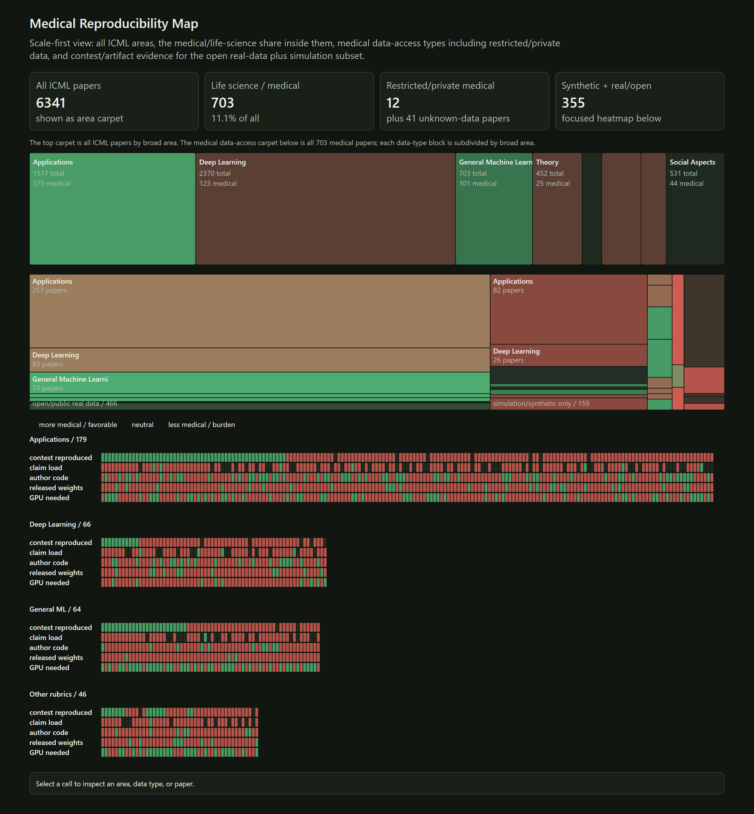

# ICML 2026 agent reproduction challenge: reproductions and verdict audit

This repository has two parts.

1. **Reproductions.** Independent reproductions of ICML 2026 papers submitted to the
   [ICML 2026 agent reproduction challenge](https://huggingface.co/spaces/ICML-2026-agent-repro/challenge)
   under [kondratevakate](https://huggingface.co/kondratevakate). Each published logbook lives on its own
   Hugging Face Space (tagged `icml2026-repro` and `paper-<orid>`); this repository holds the scripts,
   logbook mirrors and reproduction bundles behind them.
2. **Verdict audit.** Meta-research on the challenge itself, from its public verdicts: how verdicts from
   many teams were aggregated, and why medical and life-science papers were rarely decided. Frozen
   protocols, analysis code, coding sheets, results and run logs.

[](#medical-reproducibility-map)

*Medical reproducibility map of the 6,341 ICML 2026 papers in the challenge metadata (July 2026 snapshot). Top: all papers by area, with the medical and life-science share. Middle: the 703 medical papers by data access. Bottom: one column per paper in the open real-data plus simulation subset (green favourable, red a burden). Details [below](#medical-reproducibility-map).*

## Contents

| Folder | What is in it | Start with |
|---|---|---|
| [`reproductions/`](reproductions/) | 47 folders, one per reproduced paper: scripts, `.trackio/` logbook mirror, `repro_*` bundle | [`reproductions/INDEX.md`](reproductions/INDEX.md): paper, Space and the judge's verdict counts per folder |
| [`verdict_audit/`](verdict_audit/) | Protocols 1–9 with code, coding sheets, results and the drafts of two PSE9 abstracts | [`verdict_audit/README.md`](verdict_audit/README.md), then [`verdict_audit/STUDIES.md`](verdict_audit/STUDIES.md) |
| [`notes/`](notes/) | Working notes: lessons learned and judged scores, target selection, model and subscription baselines | [`notes/HANDOFF.md`](notes/HANDOFF.md) |
| [`tools/`](tools/) | Logbook scaffold and validator, medical target scan, the pipeline of the project page, the index builder | the docstring of each script |
| [`audit/`](audit/), [`docs/`](docs/) | Tables, source and a static render of the medical reproducibility map | [the map section](#medical-reproducibility-map) |

## Papers built on this repository

| Paper | Status | Draft | Evidence |
|---|---|---|---|
| Voters: how the ICML 2026 agent reproduction challenge aggregated verdicts | PSE9 2027 abstract, draft | [`verdict_audit/voters/PAPER_DRAFT.md`](verdict_audit/voters/PAPER_DRAFT.md) | [`verdict_audit/voters/`](verdict_audit/voters/README.md) |
| Unfalsifiable by default: medical papers in the ICML 2026 agent reproduction challenge | PSE9 2027 abstract, draft | [`verdict_audit/readiness/ABSTRACT_DRAFT.md`](verdict_audit/readiness/ABSTRACT_DRAFT.md) | provenance table in its Appendix A |
| A 2025–2026 baseline of reproducibility practice in life-science ML | protocol 9, data collection running | none yet | [`verdict_audit/readiness/README.md`](verdict_audit/readiness/README.md) |

## Reproducing the verdict audit

```bash
python -m pip install -r verdict_audit/requirements.txt    # Python 3.11
python verdict_audit/reproduce.py --list                   # the analysis steps
python verdict_audit/reproduce.py                          # rerun them and compare with the committed results
```

`reproduce.py` reruns each analysis from the committed coding sheets and the downloaded inputs, compares every
JSON result with the committed one, restores the committed files, and writes a log with the environment, the
git commit and a per-step status to [`verdict_audit/logs/`](verdict_audit/logs/). The last full run
(2026-10-19, 41 minutes on CPU) matched the committed results in 15 of 15 steps. The inputs that are not in
the repository (the challenge's verdict snapshot, logbook pages, conference paper lists, full texts) and the
scripts that fetch them are listed in [`verdict_audit/README.md`](verdict_audit/README.md). Coding by
language-model subagents is not rerun: its prompts and outputs are committed and the analyses start from them.

## Reproducing a paper reproduction

Each folder under `reproductions/` is self-contained: read its README or the script's docstring (the paper's
specification as transcribed), then run the script. Most use Python 3.11 with numpy and CPU torch; folders
with their own `requirements.txt` pin their environment. Downloaded datasets, the papers' official code and
paper texts are not included; [`notes/HANDOFF.md`](notes/HANDOFF.md) and, where present, a folder's
`OFFICIAL_ARTIFACTS.md` say where to get them.

## Medical reproducibility map

The interactive map is a single self-contained page, [`docs/medical-reproducibility.html`](docs/medical-reproducibility.html):
download it and open it in a browser, then click any cell to inspect an area, a data type or a paper. Once GitHub
Pages is enabled for the `docs/` folder it is served at
[`kondratevakate.github.io/icml-2026-repro/`](https://kondratevakate.github.io/icml-2026-repro/)
([`docs/index.html`](docs/index.html) redirects there). The picture at the top of this README is a static render
of the same page.

The page is a public audit of how reproducible medical and life-science ICML papers look from the challenge
metadata one month after the conference. It starts with the full scale of the corpus, then narrows to the
medically relevant papers, and finally focuses the heatmap on papers that combine synthetic experiments with
real or open datasets.

Headline counts shown on the page:

- `6,341` total ICML papers in the challenge metadata.
- `703` life-science or medical papers, `11.1%` of the full corpus.
- `355` synthetic-plus-real/open-data target papers used for the detailed reproducibility heatmap.

The focused heatmap answers the practical reproduction questions: whether the paper was reproduced in the
contest, how many claims were checked, whether authors released code, whether weights or checkpoints are
available, and whether GPU use appears necessary. Restricted, private and unknown data are shown in the
medical data-type carpet above the heatmap instead of being hidden inside the open-data subset. Dataset size
is intentionally excluded until a dedicated artifact-size audit is run.

The generated audit tables are in [`audit/`](audit/), and the pipeline is
[`tools/audit_medical_repro.py`](tools/audit_medical_repro.py). To publish the page on GitHub, enable Pages
for this repository from the `docs/` folder on the default branch.

Note: the page selects medical papers from the challenge's area tags and a title scan
(`medical_neuro_papers.csv`, [`notes/medical_throughput_shortlist.csv`](notes/medical_throughput_shortlist.csv));
the verdict audit uses labels validated by two blind coders (protocols 4, 6 and 7), so its counts differ.

## How this was made

Reproductions and analyses were written with AI coding agents, directed and reviewed by the author; commits
made with Claude carry a `Co-Authored-By` trailer. In the verdict audit every protocol freeze
and bulk download was approved by the author before it happened, and blind coding was done by Claude
subagents whose prompts are committed. The author took part in the challenge; the verdict audit excludes the
author's own logbooks.

## Licence and citation

Code is MIT-licensed ([`LICENSE`](LICENSE)). Text, protocols, coding sheets and aggregate results are CC BY 4.0
([`LICENSE-CC-BY-4.0`](LICENSE-CC-BY-4.0)). Third-party material keeps its own terms and is not redistributed
here: the papers and their official code, the challenge's datasets, and other teams' logbooks.

To cite this repository, use [`CITATION.cff`](CITATION.cff) (GitHub's "Cite this repository" button reads it).
